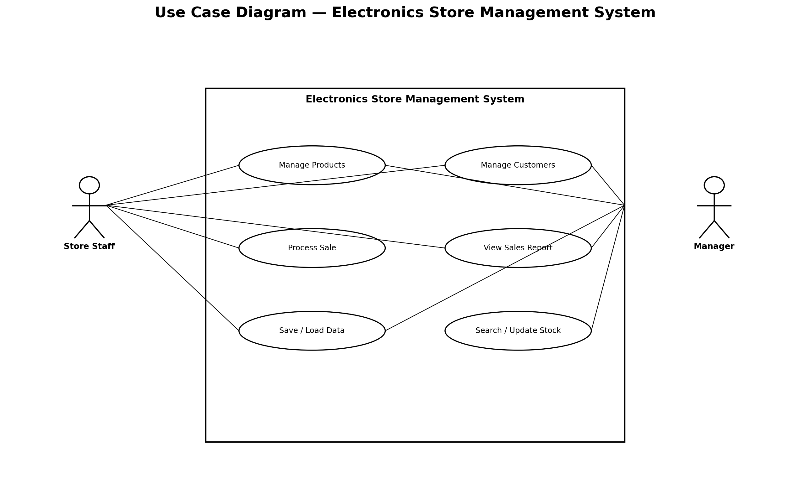
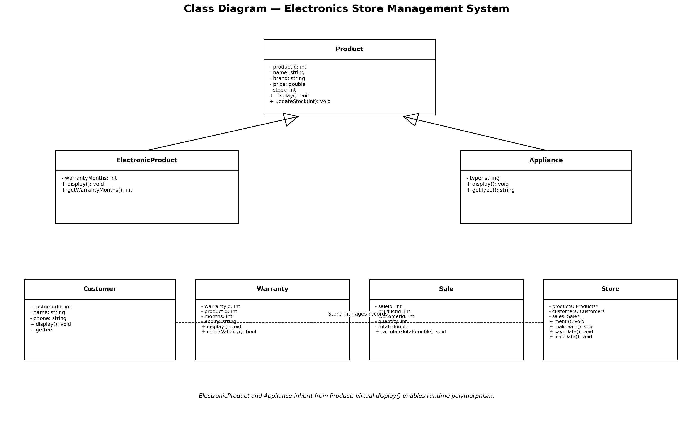
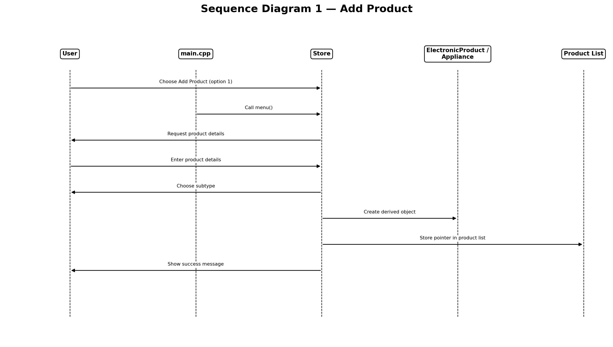
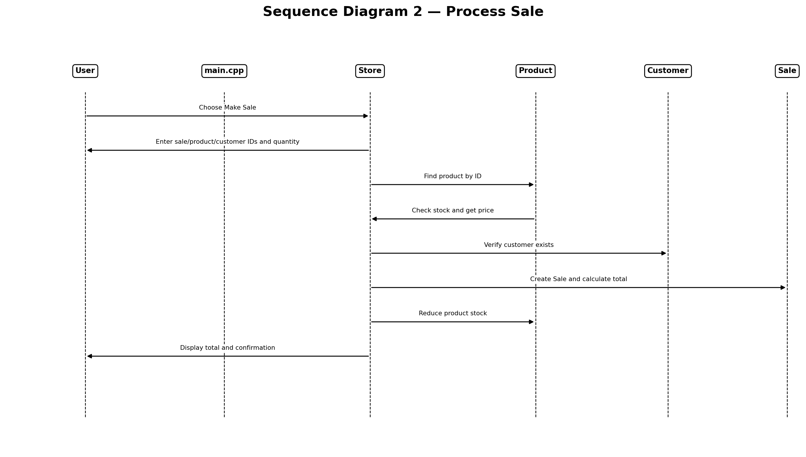

# Electronics Store Management System

## Project Information
- **Project Title:** Electronics Store Management System
- **Subject:** CPP22 - Object-Oriented Programming using C++
- **Language:** C++
- **Platform:** macOS / VS Code

## Project Description
The Electronics Store Management System is a console-based application developed using C++. It helps manage electronic products, customer records, sales transactions, and stock information.

The system provides a menu-driven interface that allows users to add, display, search, update, and delete products, manage customers, make sales, generate reports, and save or load data using files.

## Features
- Add electronic products and appliances
- Display all products
- Search products by ID
- Update product price and stock
- Delete product records
- Add and display customer records
- Process sales transactions
- Automatically calculate sale totals and update stock
- Generate sales reports
- Save and load product and customer records using files
- Validate user inputs and check product availability

## Object-Oriented Programming Concepts
- **Classes and Objects:** Used to represent products, customers, warranties, sales, and the store.
- **Encapsulation:** Product and customer data members are private and accessed through public methods.
- **Constructors:** Default and parameterized constructors initialize objects.
- **Destructors:** Destructors are used to manage object cleanup.
- **Inheritance:** ElectronicProduct and Appliance inherit from Product.
- **Runtime Polymorphism:** Virtual display functions allow derived classes to display their specific information.
- **Dynamic Memory Allocation:** Product objects and record arrays are dynamically allocated.
- **File Handling:** File streams are used to save and load product and customer records.

## Classes Used
- `Product`
- `ElectronicProduct`
- `Appliance`
- `Customer`
- `Warranty`
- `Sale`
- `Store`

## Project Structure
```text
ElectronicsStore/
├── main.cpp
├── Product.h
├── Product.cpp
├── ElectronicProduct.h
├── ElectronicProduct.cpp
├── Appliance.h
├── Appliance.cpp
├── Customer.h
├── Customer.cpp
├── Warranty.h
├── Warranty.cpp
├── Sale.h
├── Sale.cpp
├── Store.h
├── Store.cpp
├── products.txt
├── customers.txt
├── UML_Diagrams/
│   ├── 01_use_case_diagram.png
│   ├── 02_class_diagram.png
│   ├── 03_sequence_add_product.png
│   └── 04_sequence_process_sale.png
└── README.md
```
## UML Diagrams

### 1. Use Case Diagram


### 2. Class Diagram


### 3. Sequence Diagram – Add Product


### 4. Sequence Diagram – Process Sale


## Requirements
- macOS or another operating system with a C++ compiler
- Clang++ or G++
- Visual Studio Code (recommended)

## Compilation and Execution

Open the terminal in the project directory and compile the source files:

```bash
clang++ main.cpp Product.cpp ElectronicProduct.cpp Appliance.cpp Customer.cpp Warranty.cpp Sale.cpp Store.cpp -o store
```

Run the application:

```bash
./store
```

## Data Storage
Product records are stored in `products.txt`, and customer records are stored in `customers.txt`.

Use the Save Data and Load Data menu options to save and restore these records.

**Note:** Sales and warranty records are not currently saved to files.

## Limitations
- The application runs in a console interface.
- Sales and warranty records are not persisted between program executions.
- Warranty validity checking is based on the stored warranty duration.

## Author
Hemit Shah
